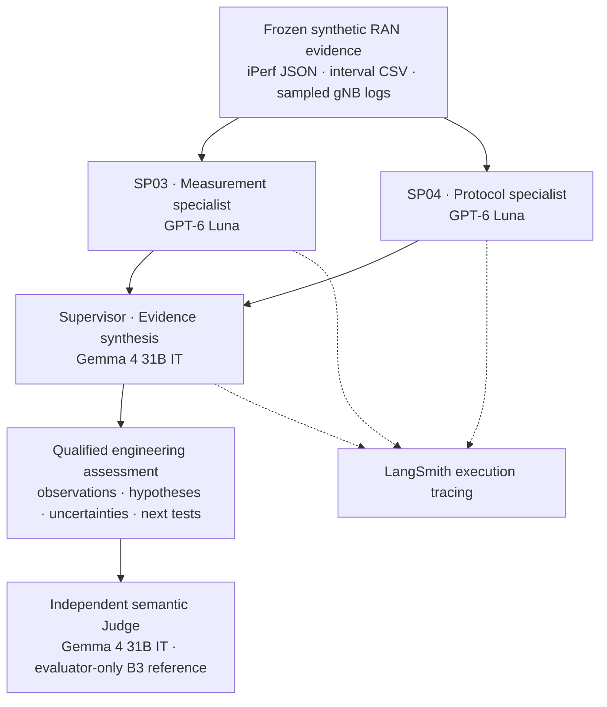

# RANalyzer — AI-Powered RAN Performance Investigation & Service Assurance

**From service measurements to evidence-grounded engineering decisions.**

RANalyzer is an experimental, multi-agent 5G Radio Access Network (RAN) investigation solution. It brings together endpoint performance measurements, sampled gNB protocol logs, specialist AI analysis and Supervisor synthesis to help telecom engineers understand **what is happening, which explanations are plausible, what remains unverified, and what to investigate next**.

This repository hosts the **customer-facing Streamlit demonstration (v1.0)**. It replays three completed synthetic-network investigations from the frozen **M05_06F v2.3.10 non-RAG** engineering baseline. It does **not** run live models, connect to operational networks or implement autonomous remediation.

> **Primary proposition:** When a network service underperforms, RANalyzer turns fragmented measurements and radio/protocol observations into a structured engineering investigation brief, with supporting evidence and explicit uncertainty.

## The operational problem

A service-performance issue can be apparent in an iPerf result, yet remain difficult to interpret. Engineers may need to reconcile sender and receiver rates, packet-loss semantics, interval behaviour, RACH/HARQ/RLC protocol records and radio-quality indicators. Those sources may refer to different UEs or observation windows, and plausible explanations are not necessarily verified causes.

RANalyzer addresses the **investigation and interpretation workflow**, not automatic root-cause verification. Potential applications include RAN troubleshooting, engineering productivity, service-quality review, incident triage and evidence-supported escalation. Site acceptance and partner quality assurance are possible extensions **subject to additional operator policies and validation**, not already delivered acceptance decisions.

### Who it is for

- **RAN engineering and optimisation teams:** interpret performance symptoms alongside sampled protocol evidence.
- **Network assurance and operations teams:** obtain a structured, reviewable diagnostic brief and recommended next checks.
- **Managed-service and delivery engineering teams:** standardise investigation reporting and preserve source attribution.
- **Engineering leaders and technical buyers:** evaluate whether repeatable, evidence-grounded investigations could improve workflows in a controlled pilot.

## What the solution produces

For a selected service-performance problem, the recorded investigation delivers:

1. **Service assessment:** sender/receiver throughput, packet-loss interpretation and interval behaviour.
2. **Supported protocol observations:** relevant sampled RAN access, MAC/HARQ, RLC/PDCP, RRC and radio-quality events with source references.
3. **Qualified hypotheses:** possible mechanisms and alternatives, without presenting correlation as verified causation.
4. **Evidence gaps:** missing UE-to-flow mapping, time alignment, full log context or discriminating counters.
5. **Recommended next investigations:** the specific measurements and correlations required for engineering review.
6. **Assurance evidence:** recorded deterministic validation, execution trace and external semantic Judge assessment.

**Operator value to test in a future pilot:** engineer time per review, time to a usable diagnostic brief, evidence completeness, unsupported-claim rates and report consistency. The available experiment has **not** quantified operational savings, mean-time-to-diagnose reduction or acceptance-quality improvement.

## Three cases — one investigation capability

| Recorded case | Operational question | What RANalyzer demonstrates | Engineering takeaway |
| --- | --- | --- | --- |
| **RAN-01 · Severe impairment** | Why is a service nearly unusable? | Reviews ~0.391 Mbps receiver throughput and 98.43% receiver packet-weighted loss alongside sampled random-access, retransmission and radio-link abnormalities. | Confirms impairment, identifies possible contributing mechanisms and specifies the correlation evidence still needed. |
| **RAN-02 · Throughput disparity** | Why is ~60 Mbps sent but only ~5 Mbps received? | Distinguishes sender/receiver throughput disparity from very low receiver-reported UDP packet loss (~0.02165%) and examines sampled RACH/RLC evidence. | Avoids an incorrect packet-loss interpretation and identifies discriminating UE, bearer and timing checks. |
| **RAN-03 · Intermittent interruption** | Why does reception stop for seven consecutive intervals? | Identifies the interval-level traffic interruption and considers sampled RSRP/A2 radio indicators. | Establishes the observed interruption while preserving uncertainty about its cause. |

These are **synthetic experimental recordings**, not measurements from a live operator network. Comparison executions are independent samples, **not** verified recoveries after a corrective action.

### Why watch the two experiences?

**Guided Case Story — _What value does RANalyzer deliver?_**  
Start with an engineering question, follow the measurements and protocol observations, and finish with a reviewable engineering assessment and next investigations.

**Interactive Agent Flow — _How did the AI produce that assessment?_**  
Inspect the saved SP03 → SP04 → Supervisor workflow, its chronological LangSmith-derived events, evidence handoffs, validation and the separate independent Judge. Replay speed is a presentation setting, **not** the actual inference speed.

The recommended visitor sequence is **the challenge → select RAN-02 → Guided Case Story → engineering deliverable → Agent Flow → Evidence Room → Results & Value**.

## How the underlying investigation works



The operational experiment uses **Python and LangGraph** with bounded, source-grounded specialist prompts. SP03 interprets UDP performance data; SP04 interprets selected gNB log evidence; the Supervisor reconciles the two without asserting unsupported causal RCA. The independent Judge runs **outside** the operational LangGraph, and the B3 evaluation reference must not enter operational-agent prompts or retrieval. The Judge shares the Supervisor's model family, which limits model-family independence.

### Technology and execution boundaries

| Function | Recorded experiment | Streamlit demonstration |
| --- | --- | --- |
| Orchestration | Python, LangGraph | No graph execution; local replay |
| SP03 / SP04 | GPT-6 Luna | Stored outputs only |
| Supervisor | Gemma 4 31B IT | Stored synthesis only |
| Assurance | Deterministic validation and independent Gemma 4 semantic Judge | Displays saved Judge results |
| Observability | LangSmith | Curated, offline trace-derived events |
| Measurements | iPerf UDP JSON and interval CSV | Bundled selected values |
| Protocol evidence | Sampled gNB logs | Bundled source-attributed summaries |
| UI and charts | Not part of the inference pipeline | Streamlit, Python, Pandas, Plotly |

**Knowledge RAG is not used in the v2.3.10 replay baseline.** Supervisor Knowledge RAG was explored separately in engineering version v2.4.1 and should not be presented as running in this demo.

## Explore the seven workspaces

| Workspace | Visitor purpose |
| --- | --- |
| **The Challenge** | Understand what RANalyzer offers, the operational questions and its investigation deliverable. |
| **Service Experience** | Inspect the recorded performance symptoms and measurement comparisons. |
| **Architecture** | Understand the technology stack, specialist responsibilities and assurance boundaries. |
| **Case Stories** | Follow scenario-specific, progressive investigations from symptom to engineering output. |
| **Agent Flow** | Play, pause, step or restart a trace-grounded replay of the specialists and Supervisor. |
| **Evidence Room** | Examine source-attributed claims, uncertainty, next evidence and provenance. |
| **Results & Value** | Review semantic evaluation results and potential operator pilot metrics. |

## Recorded experimental results

The **19 October 2026 v2.3.10 rerun** completed all three scenarios with **40/40 (100%)** on the existing ten-criterion semantic Judge rubric. The operational graphs and separate Judges completed successfully. These scores assess the recorded investigation outputs against the rubric; they are **not verified causal RCA accuracy** or operator service-level outcomes.

Critical evidence limits remain:

- No verified **UE-to-iPerf-flow mapping** or **endpoint-to-gNB-log time alignment**.
- Selected gNB messages are samples, not exhaustive event counts or rates.
- Approximately ten-second UDP tests are **not** production 15-minute performance-management counters.
- A comparison execution does **not** establish intervention, remediation or recovery.
- Retrieved reference knowledge, where explored in other versions, is not evidence that a network event occurred.
- No independently verified causal root-cause label, corrective action or recovery is available; causal RCA accuracy is **NOT_SCORABLE**.
- The saved replay is **not** live telemetry, a production integration, or a site acceptance decision.

## Run the demonstration

**Requirements:** Python 3.11+ recommended; Streamlit >=1.39 is required for fragment-based interactive playback.

```bash
python -m pip install -r requirements.txt
streamlit run app.py
```

The project reads bundled cases under `data/`. No LangSmith credentials, model API keys or operator-network access are needed. For a meaningful walkthrough, choose **RAN-02** in Case Stories, complete the sequence, then open Agent Flow to inspect how the saved assessment was produced.

### Repository structure

```text
app.py                    # Seven-workspace Streamlit visitor experience
agent_replay.py           # Trace-driven interactive agent playback
data/RAN-01.json          # Curated replay fixtures
   /RAN-02.json
   /RAN-03.json
.streamlit/               # Presentation configuration
requirements.txt          # Runtime requirements
docs/                     # Evidence boundaries, UX, pilot and architecture notes
README.md                 # Product, implementation and demonstration guide
```

## Project maturity and next steps

**Current status:** Functional experimental replay demonstration, **v1.0**. The underlying **M05_06F engineering phase is closed** and its frozen non-RAG evidence remains the reference. Browser-based customer comprehension, interaction, layout and accessibility acceptance have **not yet been independently completed** for this presentation candidate.

Next steps are to (1) independently review the Case Stories and Agent Flow with telecom stakeholders; (2) refine the UX from observed findings; and (3) define an operator pilot with approved data access, meaningful workflow baselines, security controls and engineer-reviewed outcomes before making operational performance claims.

The demo is maintained **separately from the private `ranalyzer-engineering` evidence repository**. This repository distributes only curated replay records, not the private raw LangSmith exports, frozen evaluator-only B3 reference, private full logs or restricted knowledge sources.

Additional detail: [`docs/DEMO_SCOPE.md`](docs/DEMO_SCOPE.md), [`docs/TECHNOLOGY_AND_ARCHITECTURE.md`](docs/TECHNOLOGY_AND_ARCHITECTURE.md), [`docs/TRACE_PROVENANCE.md`](docs/TRACE_PROVENANCE.md), and [`docs/OPERATIONAL_VALUE_AND_PILOT.md`](docs/OPERATIONAL_VALUE_AND_PILOT.md).


## v1.0 customer experience refinement

Guided Stories now prioritise measured symptoms, qualified interpretation, the engineering brief and next investigation. Agent Flow has a three-stage narrative with recorded nested traces available separately; replay is offline. See `docs/V1_0_ACCEPTANCE.md` for detailed regression and evidence checks.
